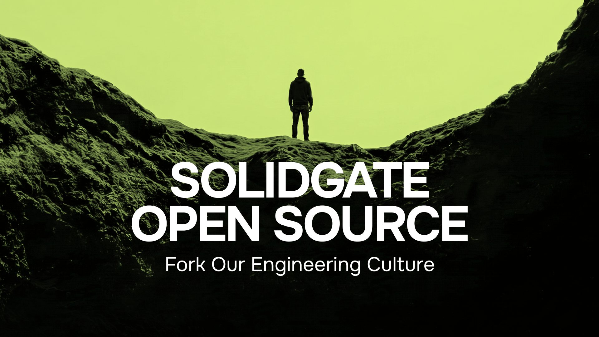

# Welcome

Solidgate is a payment orchestration platform trusted by 150+ digital businesses. We build the infrastructure behind global payments. One unified API lets businesses accept payments globally, across payment methods, currencies, and compliance requirements.

# Get started

We are starting with agent skills that Solidgate engineers use every day, published as a [Claude Code plugin marketplace](https://github.com/solidgate-tech/engineering-skills).

These are not demos. They come from our internal marketplace, where teams across the company write and share the skills they actually work with. We publish the ones that are useful outside Solidgate.

```shell
/plugin marketplace add solidgate-tech/engineering-skills
/plugin install mr-toolkit@solidgate-engineering
```

| Repository | What's inside |
|---|---|
| [engineering-skills](https://github.com/solidgate-tech/engineering-skills) | 11 Claude Code plugins: the GitLab MR loop, Go service review, Playwright tests, ADRs, observability and more |
| [solidgate-agent-skills](https://github.com/solidgate-tech/solidgate-agent-skills) | Skills for AI agents integrating with the Solidgate payment API |
| [SDKs](https://github.com/orgs/solidgate-tech/repositories?q=sdk) | Go, Node.js, Python, PHP, Kotlin, and React, Vue and Angular payment form SDKs |
| [solidgate-tech.github.io](https://solidgate-tech.github.io) | Our Tech Radar, interview guide, and how we work with AI |

# Short-term roadmap

This project grows in stages. Next up: the agents our engineers run alongside these skills every day. After that, more of the tooling.

Star the repo to follow along. Or just fork our engineering culture.

---

[Website](https://solidgate.com) · [Tech Radar](https://solidgate-tech.github.io) · [Careers](https://solidgate.teamtailor.com) · [Status](https://status.solidgate.com)
